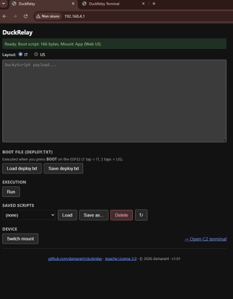
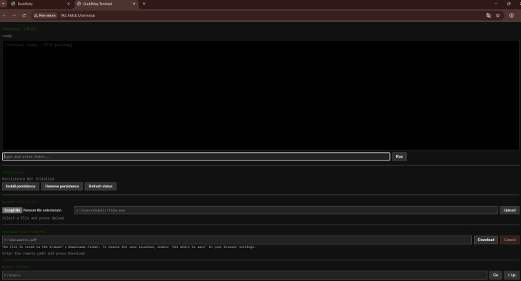

# DuckRelay

**A serial C2 bridge with DuckyScript HID injection for ESP32-S2 Mini (Wemos).**

> ⚠️ **Important notice**
> This project is provided **for educational and security research purposes only**, in controlled environments and on systems you own or for which you have explicit written authorization.
> Using this software to attack systems without consent is **illegal** and violates the terms of service of any platform. The author assumes no responsibility for improper or unlawful use.

**Version:** v1.01
**Target hardware:** ESP32-S2 Mini (Wemos)

---

## Overview

DuckRelay turns an ESP32-S2 Mini into a composite USB device that simultaneously exposes:

- a **HID keyboard** (for DuckyScript injection);
- a **CDC serial device** (C2 channel to a Windows agent);
- a **MSC mass storage** (for initial deploy and payload storage).

The firmware also includes a **Wi-Fi SoftAP** with a built-in **web UI**, which lets you manage payloads, scripts and the C2 terminal from a browser, without installing anything on the target PC other than the agent.




---

## Features

### BadUSB / HID Injection

- Runs **DuckyScript** scripts (layout **IT** or **US**) at boot, by pressing the **BOOT** button:
  - **1 tap** → deploy with IT layout;
  - **2 taps** (within 500 ms) → deploy with US layout.
- If `/usb/deploy.txt` is not readable, it runs a fallback payload (`TEST_PAYLOAD` in `tusb_composite_main.c`).

### Serial C2 channel

- Interfaces with a Windows agent (`agent.cpp`) over **USB CDC**.
- Supported commands (TLV protocol, see `c2_protocol.h`):
  - **EXEC**: remote command execution with stdout/stderr capture and return code;
  - **UPLOAD**: file transfer PC1 → PC2 (chunked, with ack);
  - **DOWNLOAD**: file transfer PC2 → PC1 (chunked, with cooperative abort);
  - **PING/PONG**: keep-alive;
  - **EXIT**: clean shutdown.
- The agent is **resilient**: 15-minute initial retry (covers the "PC on before connecting the ESP32" case) and an automatic reconnect loop.

### Built-in Web UI

Accessible over Wi-Fi (AP mode) at `http://192.168.4.1/`:

- **Home** (`/`): DuckyScript editor for `deploy.txt`, IT/US layout selector, saved scripts list (load/save/delete/refresh), mount switch, link to the terminal.
- **Terminal** (`/terminal`): remote command execution, file upload, file download, folder browsing, persistence management.

### Persistence

- Installs the agent as a **Scheduled Task** on Windows (via `schtasks`).
- Task name: `Riagent`.
- Executable: `%USERPROFILE%\.riagent\riagent.exe`.
- Triggers: logon + repetition every minute.

---

## Requirements

### Hardware

- **ESP32-S2 Mini (Wemos)** or an equivalent ESP32-S2 board.
- USB data cable (not power-only).
- Windows PC to run the agent.


### Software

- **[ESP-IDF](https://docs.espressif.com/projects/esp-idf/en/latest/esp32s2/get-started/)** v5.x or newer.
- **`espressif/esp_tinyusb`** component (downloaded automatically by `idf.py` via `idf_component.yml`).
- **[MinGW-w64](https://www.mingw-w64.org/)** with `g++` in `PATH` (to build the agent).
- Modern browser (Chrome, Firefox, Edge) for the web UI.

---

## Repository layout

```text
duckrelay/
|-- CMakeLists.txt              (ESP-IDF project)
|-- partitions.csv              (partition table)
|-- sdkconfig.defaults          (default configuration)
|-- dependencies.lock           (dependency lock, generated)
|-- LICENSE                     (Apache License 2.0)
|-- NOTICE                      (third-party notices: TinyUSB MIT, etc.)
|-- README.md
|-- .gitignore
|-- deploy_assets/              (files to place on the ESP32 USB)
|   |-- agent.exe               (compiled agent, release)
|   |-- deploy.bat              (deploy script)
|   |-- deploy.txt              (boot DuckyScript payload, sample)
|   `-- run.vbs                 (launches deploy.bat without a cmd window)
|-- main/                       (firmware sources)
|   |-- agent.cpp               (Windows agent source)
|   |-- c2_client.c/.h          (firmware-side C2 client)
|   |-- c2_protocol.h           (TLV protocol definition)
|   |-- payload_parser.c/.h     (DuckyScript parser)
|   |-- tusb_composite_main.c   (firmware main)
|   |-- web_server.c/.h         (web server + HTML UI)
|   |-- wifi_ap.c/.h            (Wi-Fi SoftAP)
|   |-- version.h               (firmware version)
|   |-- CMakeLists.txt
|   `-- idf_component.yml
`-- screenshot/
    |-- DuckRelay_Ducky.jpg
    `-- DuckRelay_Terminal.jpg
```

## Installation and build

### 1. Clone the repository

```bash
git clone https://github.com/damarant/duckrelay.git
cd duckrelay
```

### 2. Build and flash the firmware

```bash
idf.py set-target esp32s2
idf.py build
idf.py flash monitor
```

On the first `build`, `idf.py` automatically downloads the `espressif/esp_tinyusb` component via the Component Manager.

### 3. Build the Windows agent

The agent can be built with **MinGW-w64**. There are two configurations:

**Debug build** (with symbols, for diagnostics):

```bash
g++ -O0 -g -o agent_debug.exe agent.cpp -lsetupapi
```

**Release build** (optimized, statically linked, for actual deploy):

```bash
g++ -Os -static -s -mwindows -ffunction-sections -fdata-sections \
    -Wl,--gc-sections -o agent.exe agent.cpp -lsetupapi
```

The `agent.exe` executable is **not included in the repository** (see `.gitignore`): it is distributed via **GitHub Releases**.

---

## Initial deploy

### What to put on the ESP32 USB

Connect the ESP32 to the PC. It will show up as mass storage. Copy the files from `deploy_assets/` into the USB root:

|File|Purpose|
|---|---|
|`agent.exe`|Windows agent (release)|
|`deploy.bat`|deploy script (copies/renames to `riagent.exe` and launches it)|
|`deploy.txt`|boot DuckyScript payload (customizable)|
|`run.vbs`|launches `deploy.bat` without showing the cmd window|

### How `deploy.bat` works

1. **Pre-check**: checks whether `riagent.exe` is already running (`tasklist`). If so, it **exits silently** without touching anything (avoids locked files).
    
2. **Search for `agent.exe`** on drives `d:\` … `z:\`.
    
3. **Cleanup** of the `%USERPROFILE%\.riagent\` folder (removes leftovers).
    
4. **Creates** `%USERPROFILE%\.riagent\` if missing and hides it (`attrib +h`).
    
5. **Copies** `agent.exe` from the USB to `%USERPROFILE%\.riagent\agent.exe`.
    
6. **Renames** it to `%USERPROFILE%\.riagent\riagent.exe`.
    
7. **Launches** `riagent.exe`.
    

If the pre-check fails (e.g. `tasklist` not available), the flow proceeds with an **aggressive fallback**: when in doubt, it attempts the deploy anyway.

### BOOT trigger

- Press the **BOOT** button once → deploy with **IT** layout.
    
- Press the **BOOT** button twice (within 500 ms) → deploy with **US** layout.
    

The firmware runs the contents of `/usb/deploy.txt` as a DuckyScript.

---

## Usage

### 1. Wi-Fi connection

The ESP32 creates a **SoftAP**:

|Parameter|Value|
|---|---|
|**SSID**|`DuckRelay`|
|**Password**|`password123`|
|**Type**|WPA2-PSK|
|**Visibility**|**hidden network** (`ssid_hidden = 1`)|
|**IP**|`192.168.4.1`|
|**Max connections**|4|

> ⚠️ The password is a **default** and is intended for lab use only. **Change it** in `main/wifi_ap.c` (constants `WIFI_SSID` and `WIFI_PASS`) before any real use.  
> Since it is a **hidden network**, you will need to add it manually from your device (it will not appear in the list of available networks).

### 2. Web UI

Open `http://192.168.4.1/` in your browser.

**Home (`/`):**

- DuckyScript editor for `deploy.txt`;
    
- IT/US layout selector;
    
- saved scripts list (load/save/delete/refresh);
    
- mount switch (App ↔ Host);
    
- link to the C2 terminal.
    

**Terminal (`/terminal`):**

- remote command execution;
    
- file upload (PC1 → PC2);
    
- file download (PC2 → PC1);
    
- browse target folders;
    
- install/remove/status of persistence.
    

### 3. Persistence

From the `/terminal` page:

- **Install persistence** → creates the `Riagent` Scheduled Task that runs `%USERPROFILE%\.riagent\riagent.exe` at logon;
    
- **Remove persistence** → deletes the task;
    
- **Refresh status** → checks whether the task exists.
    

---

## Technical notes

### Mount point

The ESP32-S2 can expose the MSC storage in two modes:

- **App**: the filesystem is accessible from the firmware (the web UI can read/write it). The PC **does not** see the storage.
    
- **USB**: the filesystem is exposed to the PC as mass storage. The firmware **cannot** access it.
    

From the web UI you can use **Switch mount** to move from one mode to the other.

### Logging

- **Firmware logs (Tera Term)**: uses `ESP_LOG*`. They remain in Italian.
    
- **Agent logs**: writing to `%USERPROFILE%\.riagent\agent.log` is **disabled** (soft-disabled) in the current version. The `log_init`/`log_close`/`logf_` functions are no-ops, but the `LOG(...)` calls remain in the code so logging can be easily re-enabled in the future.

### Serial console (UART0)

The ESP32-S2 Mini (Wemos) exposes two independent USB/serial paths:

- **Native USB OTG (D-/D+)**: used for flashing, the C2 CDC channel and the MSC mass storage.
- **UART0 (GPIO37 = TX, GPIO39 = RX)**: used only for `ESP_LOG*` output.

By default, ESP-IDF logs go to UART0 at **115200 8N1**. On the S2 Mini Wemos, UART0 is remapped to **GPIO37 (TX)** and **GPIO39 (RX)** because the default pins are shared with the native USB.

To read the logs **in parallel** with the C2 channel (without occupying the native USB port), connect an **FT232** (or any USB-to-UART adapter) as follows:

| FT232 pin | ESP32-S2 pin | Notes |
|---|---|---|
| RX | GPIO37 (TX) | crossover: ESP TX → FT RX |
| TX | GPIO39 (RX) | crossover: ESP RX ← FT TX |
| GND | GND | common ground required |
| VCC | — | **do not connect**: the board is powered by its native USB |

Then open a serial terminal (e.g. Tera Term) on the FT232 COM port with **115200 8N1, no flow control**. You will see the boot log, including:

```
I (xxx) example_main: DuckRelay firmware v1.01 starting
I (xxx) wifi_ap: SoftAP started (hidden). SSID:DuckRelay password:password123 IP:192.168.4.1
I (xxx) web: HTTP server started on http://192.168.4.1/
```


Using the FT232 for logs keeps the native USB port free for flashing and the C2 channel, so both can be used at the same time.

> ℹ️ The `-b 115200` option in `idf.py flash` is the **flash baud rate** (native USB), not the UART0 log baud rate. They are two independent settings, even though they happen to share the same value (115200).

### C2 protocol

Defined in `main/c2_protocol.h`. Frame format: `[tag:1B][len:4B LE][payload:len B]`. Supported tags:

|Tag|Direction|Meaning|
|---|---|---|
|`EXEC` (0x01)|PC1 → PC2|execute command|
|`STDOUT` (0x02)|PC2 → PC1|stdout output|
|`STDERR` (0x03)|PC2 → PC1|stderr output|
|`RC` (0x04)|PC2 → PC1|return code|
|`PING` (0x05) / `PONG` (0x06)|bidirectional|keep-alive|
|`EXIT` (0x07)|PC1 → PC2|shutdown|
|`UPLOAD_*` (0x08–0x0B)|PC1 → PC2|file upload|
|`DOWNLOAD_*` (0x0C–0x0F)|PC2 → PC1|file download|
|`ABORT_DOWNLOAD` (0x10)|PC1 → PC2|abort download|

---

## Limitations and security notes

- The web interface is served over **plain HTTP**, **without authentication**. Anyone connected to the AP can use it.
    
- The SoftAP **is not designed for Internet exposure**. Use it only on controlled local networks.
    
- The **Wi-Fi password is a default** (`password123`): change it before any real use.
    
- The device handles **a single target at a time** (a Windows PC with the agent running).
    
- `agent.exe` **is not included in the repository**: it is distributed only via **GitHub Releases**.
    
- Windows Defender or other antivirus solutions may block the execution of `riagent.exe` (heuristic detection of automation tools). The block can be bypassed, but for the educational purpose of this project **no evasion method is provided**: if the agent is blocked, temporarily disable real-time protection on a lab machine, or add a targeted exclusion for `%USERPROFILE%\.riagent\riagent.exe`.

---

## License

Released under the **Apache License 2.0**. See the [`LICENSE`](LICENSE) file for details.

The [`NOTICE`](NOTICE) file contains information about third-party components:

- **ESP-IDF** (Apache 2.0);
    
- **TinyUSB** (MIT);
    
- **esp_tinyusb** (Apache 2.0).
    

---

## Legal notes and disclaimer

This software is provided **"as is"**, without warranties of any kind. The user is solely responsible for complying with the laws applicable in their country. The author is not liable for any damages or legal consequences arising from the use of this tool.

---

## Credits

- **Author**: damarant
    
- **Repository**: [github.com/damarant/duckrelay](https://github.com/damarant/duckrelay)
    
- **License**: Apache License 2.0
    
- **Reference hardware**: ESP32-S2 Mini (Wemos)
    
- **Framework**: [ESP-IDF](https://github.com/espressif/esp-idf)
    
- **USB stack**: [TinyUSB](https://github.com/hathach/tinyusb) via [espressif/esp_tinyusb](https://components.espressif.com/components/espressif/esp_tinyusb)